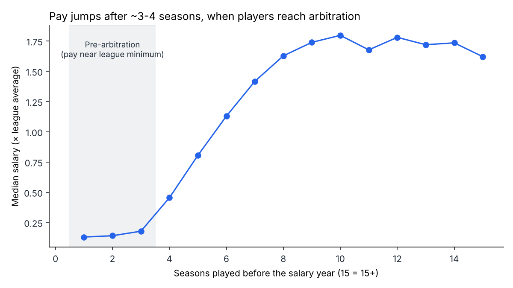
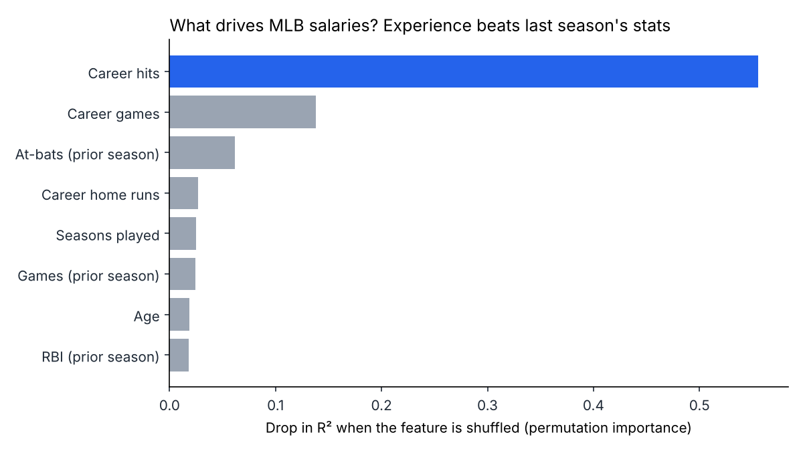
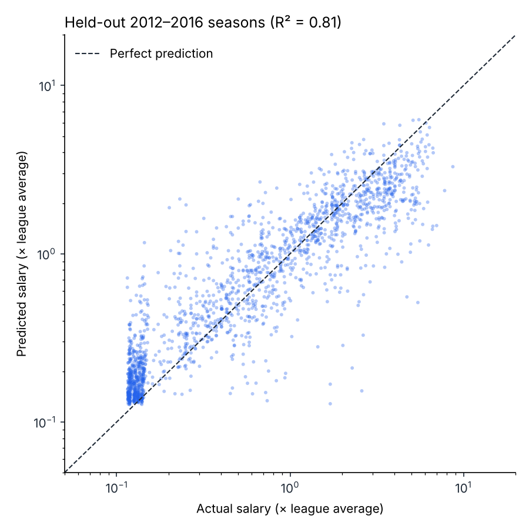

# MLB Salary Drivers

What actually determines how much an MLB hitter gets paid? This project builds features from 30+ years of player data in SQL, then trains models in Python to predict salaries for seasons they have never seen.

**Short answer: experience matters far more than last season's stats.** A player's career hits and games played predict next year's pay better than his batting average, home runs, or OPS. That lines up with how MLB contracts work: players earn close to the league minimum for their first ~3 seasons, then pay jumps once they reach salary arbitration.



## Results

Trained on 1985–2011, tested on **held-out 2012–2016 seasons** (1,774 player-seasons the models never saw).

| Model | R² (test) | Mean absolute error |
|---|---|---|
| Linear regression | 0.65 | $2.56M |
| **Gradient boosting** | **0.81** | **$1.85M** |

A logistic regression classifier picks out **top-25% earners with 87% accuracy** (ROC AUC 0.95), compared with 68% for always guessing "not top 25%."





## Data

[Lahman Baseball Database](https://sabr.org/lahman-database/) (via the `pylahman` package): 10,997 player-seasons for 1,968 position players, 1985–2016.

## How it works

1. **Load:** `src/load_data.py` loads the salary, batting, appearance, and player tables into SQLite.
2. **Feature engineering in SQL:** `sql/build_features.sql` uses CTEs and window functions to build one row per player per salary year:
   - `SUM() OVER (... ROWS BETWEEN UNBOUNDED PRECEDING AND CURRENT ROW)` for career totals to date
   - `ROW_NUMBER() OVER` to count seasons played
   - `LAG()` to measure the year-over-year change in home runs
   - `PERCENT_RANK()` and `AVG() OVER (PARTITION BY year)` to compare each salary with the rest of the league that year
   - Every stat comes from the season *before* the salary year, so the model only uses information a team would have had.
3. **Normalize for inflation:** salaries rose about 6x from 1985 to 2016, so the target is `log(salary / league average that year)`.
4. **Model:** `src/model.py` uses a time-based train/test split (no peeking at the future), linear regression vs. gradient boosting, and permutation importance to rank drivers.
5. **Tests and CI:** `pytest` checks data quality (no duplicate player-seasons, valid rate stats, no missing features), and GitHub Actions runs the tests and the full pipeline on every push.

## Run it

```bash
pip install -r requirements.txt
python run_analysis.py   # builds the database, trains models, writes reports/
pytest -q
```

## Project structure

```
sql/build_features.sql   Feature engineering (CTEs, window functions)
src/load_data.py         Loads Lahman tables into SQLite
src/model.py             Time-split training, evaluation, feature importance
src/charts.py            Figures in reports/figures/
run_analysis.py          End-to-end pipeline
tests/                   Data-quality tests
```

## Limitations

- Pitchers are excluded; their pay depends on different stats.
- Contract length and free-agency timing aren't in the data, which is a big part of the remaining error.
- Lahman salary data ends in 2016.
